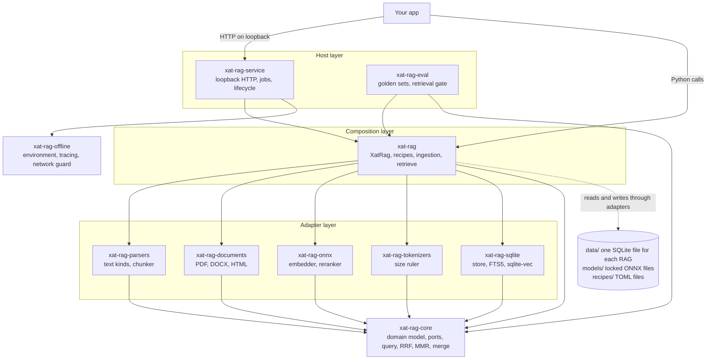
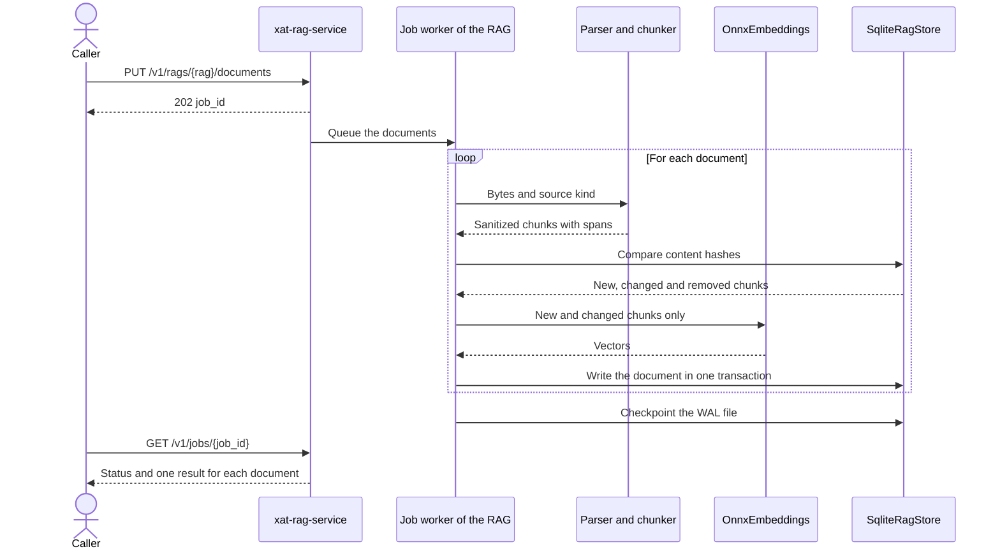
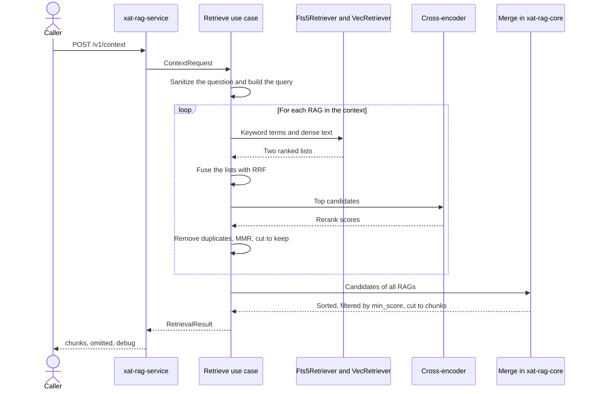

# Architecture

xat-rag stores documents in named RAGs, and it returns the most relevant chunks for a question. It is a modular monolith in one uv workspace. This page shows the layers and how they work together. The [API reference](api.md) gives the routes, fields and limits.

## System overview

An arrow means "depends on". The `uv run lint-imports` command checks these dependencies in CI.

## Layers

| Layer | Packages | Job | Import rule |
|---|---|---|---|
| Host | `xat-rag-service`, `xat-rag-eval` | Give xat-rag to a caller. The service adds HTTP, request checks, upload parsing, jobs and the lifecycle. The evaluation package measures the retrieval quality. | Can import the composition layer. The composition layer cannot import the service. |
| Composition | `xat-rag` | Load the recipes, connect the adapters and run the two use cases: ingestion and retrieval. It holds the public class `XatRag`. | Can import the adapters and the domain. |
| Adapter | `xat-rag-parsers`, `xat-rag-documents`, `xat-rag-onnx`, `xat-rag-tokenizers`, `xat-rag-sqlite` | Connect one external technology to a port of the domain. | Can import the domain only. Adapters do not import each other. |
| Domain | `xat-rag-core` | Hold the model, the ports, the errors, sanitizing, the query build, RRF, MMR and the merge. | Imports no other workspace package. |
| Hardening | `xat-rag-offline` | Remove tracing and secret variables, and block network access outside loopback. | Imports no workspace package and no LangChain package. |

No package can import `langchain`, `langchain_community`, `langchain_classic` or `tiktoken`.

## Ports and adapters

The domain and the composition layer use these ports. A LangChain interface is the port where a matching interface exists.

| Component | Port | Adapter |
|---|---|---|
| Parser | `SectionParser` | One parser for each source kind, in `xat-rag-parsers` and `xat-rag-documents` |
| Chunker | None | `StructuralChunker` |
| Embedder | LangChain `Embeddings` | `OnnxEmbeddings` |
| Keyword search | LangChain `BaseRetriever` | `Fts5Retriever` |
| Vector search | LangChain `BaseRetriever` | `VecRetriever` |
| Reranker | LangChain `BaseDocumentCompressor` | `OnnxCrossEncoderCompressor` |
| Store and manifest | None | `SqliteRagStore` and `IndexManifest` |
| Size ruler | `TokenCounter` | `HfTokenCounter` |

## Start of the service

The order matters, because the hardening must run before any LangChain import.

1. `main` reads the data folder with the standard library only.
2. `harden_process` cleans the environment and installs the network guard.
3. `run` reads the settings and takes the lock of the data folder.
4. `run` deletes a stale ready file.
5. `XatRag.open` loads the recipes, checks the model files and opens the indexes.
6. The server starts to listen on loopback.
7. The service writes the ready file with its URL.

A failure in these steps stops the service with exit code 2.

## Ingestion

The caller pushes documents. xat-rag never fetches a document by itself.

- Each RAG has one worker thread. Jobs of one RAG run in order, and jobs of different RAGs run in parallel.
- SQLite runs in WAL mode, so questions continue during ingestion.
- A bad document gets a `failed` result. The other documents continue.
- Jobs live in memory, so a restart loses them. The indexes stay correct, because each document is one transaction.

## Retrieval

- Keyword search finds exact terms, such as error codes, file paths and JIRA keys. Vector search finds text that uses other words.
- All RAGs of a context use the same reranker, so their scores can be compared.
- Blocking work runs in a pool of two worker threads, and never on the event loop.
- Each stage has a time limit in the context recipe. A stage that passes its limit gives `stage_timeout_error`.
- Ties in a score are broken by `chunk_id`, so one input gives one order on one platform.

## Index safety

Each RAG is one SQLite file. The file has a manifest that records the embedder, the chunkers, the tokenizer versions and a hash of the recipe fields that change the index.

xat-rag compares the manifest with the loaded models and recipes. On a mismatch, it refuses the index and returns `index_mismatch_error`. It never embeds again without a request. The caller rebuilds the RAG and uploads the documents again.

The model files are locked by `build/models.lock.json`. xat-rag checks their size and sha256 at start, and it never downloads a file at runtime.

## Boundaries

| xat-rag does | The app does |
|---|---|
| Parse, chunk and index the documents that the app sends. | Find the documents and send them. |
| Build a search query from a question. | Prepare a long or noisy question. |
| Return ranked chunks with their sources. | Count tokens and choose the chunks that fit its LLM. |
| Sanitize control characters. | Escape the text, and build the prompt. |
| Give a stable ID for each chunk. | Call the LLM and check the citations. |

xat-rag accepts only loopback connections, sends no telemetry and has no authentication. Each program on the same machine can use the service. The text of a chunk is untrusted, so the app must not treat it as instructions.
