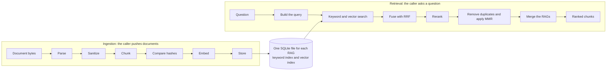
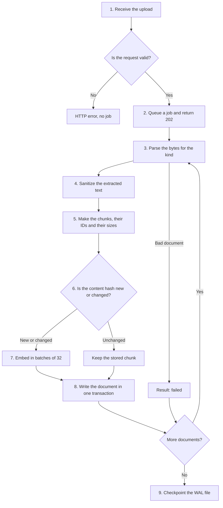
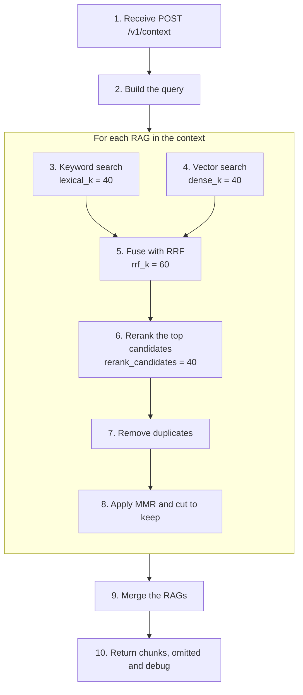
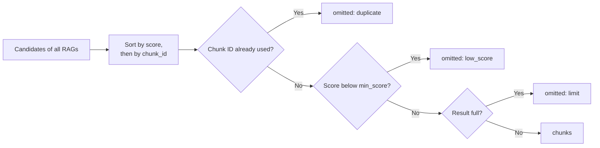

# How xat-rag works

This page explains the full process, step by step. The first part follows a document from upload to index. The second part follows a question from request to ranked chunks. The [architecture](architecture.md) page shows the packages, and the [API reference](api.md) lists the fields and limits.

## The full process



## Terms

| Term | Meaning |
|---|---|
| RAG | One named index, with one SQLite file. Its RAG recipe gives its source kinds, its models and its search values. |
| Context | A named group of RAGs that one question searches. A context recipe defines it. |
| Document | One file that the caller sends, with a `doc_id`. |
| Chunk | One part of a document, with a stable `chunk_id`. A search returns chunks. |
| Candidate | A chunk that a search found, before the final result. |
| Span | The lines, pages or blocks of the document that hold a chunk. |

## Ingestion

Ingestion turns document bytes into searchable chunks. It runs in the background, because a large batch can take minutes on a CPU.



### Step 1: Receive the upload

The caller sends `PUT /v1/rags/{rag}/documents` with a multipart body. The service checks the `Host` and `Origin` headers, the size of the request and the `documents` list. Each document must use a source kind that the RAG has in its recipe. The bytes stay in memory, and they never go to a temporary file.

### Step 2: Queue the job

The service returns 202 and a `job_id` at once. The caller reads the progress with `GET /v1/jobs/{job_id}`.

Each RAG has one worker thread. Jobs of one RAG run in order, and jobs of different RAGs run in parallel. SQLite runs in WAL mode, so questions continue during ingestion. Queued upload bytes can total 256 MiB. More uploads get 503.

### Step 3: Parse

A parser reads the bytes and returns sections. No parser opens a path or a URL.

| Kind | How the parser finds the structure |
|---|---|
| Markdown | Headings give the heading path. |
| Text | The whole document is one section. |
| Diff | Each hunk of each file is one section. Binary files are skipped, with a note. |
| JIRA | The summary and description are one section. Each comment is one section, and its parent is the description. |
| Prompt | The whole file is one section. |
| PDF | The outline gives the heading path when it exists. Otherwise, each page is one section. |
| DOCX | The `Heading 1` to `Heading 9` styles give the heading path. Tables become pipe rows in their section. |
| HTML | `h1` to `h6` give the heading path. Active and hidden elements are removed. |

PDF has no OCR. xat-rag indexes only the pages whose sanitized text has at least `min_page_chars` non-space characters. The result of the document lists the skipped pages.

One binary parse runs at a time in the process. Each document has a deadline of 60 seconds, and the parsers check it between pages, blocks, sections and comments. The [limits](api.md#limits) protect the service against bad files. A document that passes a limit gets a `failed` result, and the other documents continue.

### Step 4: Sanitize

Sanitizing runs on the extracted text, before chunking. Thus, the spans and the hashes come from the same text that xat-rag stores. Sanitizing does these changes:

- It removes ANSI codes and control characters, except tab, line feed and carriage return.
- It removes zero-width characters, bidirectional controls, Unicode tag characters and variation selectors.
- It turns NEL and the line and paragraph separators into line feeds.
- It normalizes the text to NFC.

Sanitizing does not make the text safe for a prompt. The app must still escape it.

### Step 5: Chunk

The structural chunker makes one chunk from each section. Each chunk has a `header` with its heading path, its `text`, its `span` and its `metadata`.

A section that is too large is split again. The chunker splits at paragraph, line and word boundaries first. A single token that is still too large is cut at a character position. A chunk must fit two limits:

| Limit | Measured with | Value |
|---|---|---|
| `max_chunk_tokens` of the source | The size ruler, the fixed tokenizer of xat-rag | 350 by default, from 32 to 2000 |
| Embedder input | The tokenizer of the embedder | 510 tokens, of the 512 that the model accepts |

An empty section gets no chunk, but it keeps its ID slot. Thus, the IDs of later sections do not change when it gets text.

A chunk ID is `<doc_id>#<anchor>`. The anchor comes from the structure of the document, so an ID stays stable across uploads.

| Source | Anchor | Example chunk ID |
|---|---|---|
| Markdown, DOCX, HTML, PDF with an outline | Heading path | `docs:orders.md#h/orders-service/ports-and-health` |
| PDF without an outline | Absolute page number | `docs:manual.pdf#p/12` |
| Text | `t` | `docs:notes.txt#t` |
| Diff | File path and hunk number | `diffs:4f2a9c1.diff#f/src/OrderService.java/hunk/1` |
| JIRA | `desc`, or `comment/<id>` | `jira:PROJ-123.json#comment/10023` |
| Prompt | `prompt` | `prompts:style-guide.md#prompt` |

If two sections get the same anchor, the later one gets `~2`, then `~3`. A split piece gets the ID `<section id>/~s<N>`.

The chunker also records the size of each chunk. The size ruler counts the header and the text together. The API shows this count as `size_tokens`. It has no link to the LLM of the app, so the app must count tokens with the tokenizer of its own LLM.

A document that gives no chunks gets a `failed` result with the reason `invalid`.

### Step 6: Compare the hashes

Each chunk has a `content_hash`, the sha256 of its header and text. xat-rag compares each hash with the store:

- A chunk with the same hash is unchanged, so xat-rag does not embed it again.
- A new or changed chunk goes to the next steps.
- A stored chunk that is no longer in the document is deleted.

Thus, a repeated upload is cheap, and a job that stopped does not repeat finished work.

### Step 7: Embed

`OnnxEmbeddings` runs `bge-small-en-v1.5` on the CPU, in batches of 32. The input is the header and the text of the chunk. Each chunk becomes a vector with 384 dimensions. A document text is never cut at this step. If a text does not fit the model, the embedder raises an error.

### Step 8: Store

`SqliteRagStore` writes each document in one transaction. A failure cannot leave half a document in the index. The transaction updates these parts:

- The document and chunk rows.
- The keyword index, in SQLite FTS5.
- The vector index, in sqlite-vec.

Before it inserts text in FTS5, xat-rag expands code names. The full compound stays, and its parts are added:

| Text | Tokens |
|---|---|
| `com.shop.OrderNotFoundException` | `com_shop_ordernotfoundexception`, `com`, `shop`, `ordernotfoundexception`, `order`, `not`, `found`, `exception` |
| `snake_case` | `snake_case`, `snake`, `case` |
| `camelCase` | `camelcase`, `camel`, `case` |
| `PROJ-123` | `proj_123`, `proj`, `123` |
| `4f2a9c1` | `4f2a9c1` |

### Step 9: Finish the job

The service checkpoints the WAL file when a job finishes all its documents. A cancelled job does not checkpoint. Each document has a result with the status `created`, `updated`, `unchanged` or `failed`.

## Retrieval

Retrieval turns a question into a ranked list of chunks. It calls no LLM.



The values in the diagram are the defaults. Each RAG recipe can change them.

### Step 1: Receive the request

The caller sends `POST /v1/context` with a context name and a question. The service checks the request and finds the context recipe. At most `XatRag__QueueLimit` requests can wait or run in the pool. More requests get 503. Blocking work runs in a pool of two worker threads.

### Step 2: Build the query

`build_query()` sanitizes the question. Line breaks and tabs become spaces. A question with no text after this step gets 400. The function then makes three texts, because each stage needs a different input.

| Part | Used by | Content |
|---|---|---|
| `lexical_terms` | Keyword search | At most 32 unique terms. Code names stay whole, for example `OrderService.java` or `PROJ-123`. |
| `dense_text` | Vector search | The whole question. The embedder uses only the part that fits its input of 512 tokens. |
| `rerank_text` | Reranker | The first 600 characters. The reranker cuts this query to 256 tokens. |

Thus, put the most important text first in a long question.

### Step 3: Keyword search

`Fts5Retriever` searches the FTS5 index with BM25. It applies the same code-name expansion to the query terms as ingestion does. Each token is in double quotes and the tokens are joined with `OR`, so that a question cannot use the FTS5 query syntax. This search finds exact terms, such as error codes, file paths, JIRA keys and commit SHAs.

### Step 4: Vector search

`VecRetriever` embeds the dense text, with the query prefix of the model. It then finds the nearest vectors in sqlite-vec. This search finds text that has the same meaning in other words. The query is embedded once for each RAG.

### Step 5: Fuse with RRF

Reciprocal rank fusion (RRF) combines the two lists. It uses only the ranks, because BM25 scores and vector distances are on different scales. A chunk gets this score:

```text
rrf_score = 1 / (rrf_k + keyword_rank) + 1 / (rrf_k + vector_rank)
```

A list that did not find the chunk adds nothing. A chunk that both searches find gets a high score. The top `rerank_candidates` chunks continue.

### Step 6: Rerank

The cross-encoder `ms-marco-MiniLM-L6-v2` reads the question and each candidate together, and it gives a new score. This step is slower, but it is more accurate than the searches. If a pair is longer than 512 tokens, the reranker cuts the end of the chunk text. The `debug` list then shows `rerank_truncated: true`.

A RAG with `reranker = "none"` skips this step, and its score is the RRF score. A rerank score is a raw value of the model. It is not a probability, and it has no fixed range.

### Step 7: Remove duplicates

A candidate is a duplicate when it has the same content hash as a better candidate, or a cosine similarity of 0.95 or more. It goes to `omitted` with the reason `duplicate`.

### Step 8: Apply MMR and cut to `keep`

Maximal marginal relevance (MMR) chooses chunks that are relevant and different from each other. The `mmr_lambda` value sets the balance, and the default is 0.7. A higher value prefers relevance. Each RAG gives at most `keep` chunks to the merge.

A chunk that this step removes is not listed in `omitted`, and it does not come back later.

### Step 9: Merge the RAGs



All RAGs of a context use the same reranker, so their scores are on one scale. A chunk with a score equal to `min_score` stays. Ties are broken by `chunk_id`, so one input gives one order on one platform.

### Step 10: Return the result

The response has three fields:

- `chunks`: the chunks in rank order, each with its `text`, `header`, `source` and `metadata`.
- `omitted`: the candidates that were found but not returned, with the reason.
- `debug`: the ranks and scores of each candidate, when the request asks for them.

Each stage has a time limit in the context recipe. xat-rag checks a limit after its stage ends, and it does not stop a stage in the middle. A stage over its limit gives `stage_timeout_error`.

xat-rag stops here. The app [fits the chunks to its LLM](quickstart.md#6-what-your-app-must-do), builds the prompt and checks the citations.

## A worked example

This example uses the document of the [quickstart](quickstart.md#upload-a-document). The numbers come from a real run.

**Ingestion.** The Markdown parser finds two sections under the title `Orders service`. The job result has `chunks: 2` and `embedded: 2`. An upload of the same bytes embeds nothing again.

| Chunk ID | Header | Lines |
|---|---|---|
| `docs:orders.md#h/orders-service/ports-and-health` | `Orders service > Ports and health` | 5 to 6 |
| `docs:orders.md#h/orders-service/database-timeouts` | `Orders service > Database timeouts` | 10 |

**Retrieval.** The question is "Which port does the orders service use?", and the context is `ask-docs`.

| Chunk | Keyword rank | Vector rank | RRF score | Rerank score |
|---|---|---|---|---|
| `ports-and-health` | 1 | 1 | 1/61 + 1/61 = 0.0328 | 8.02 |
| `database-timeouts` | 2 | 2 | 1/62 + 1/62 = 0.0323 | -0.25 |

The RRF scores are almost equal, because the document has only two chunks. The reranker separates them clearly. Both scores are above the `min_score` of -5, so both chunks pass. With `"chunks": 1`, the second chunk goes to `omitted` with the reason `limit`.
